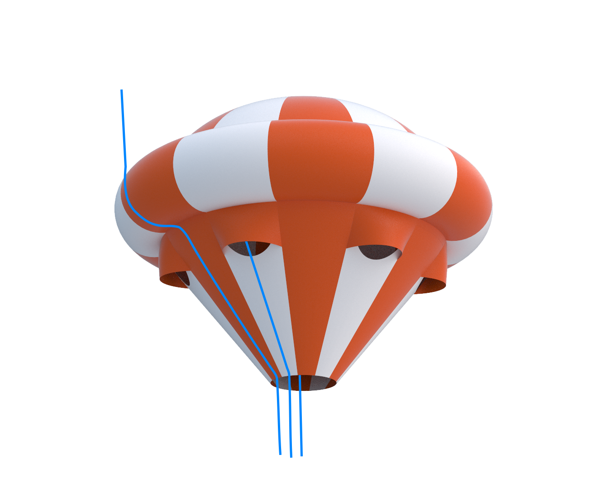
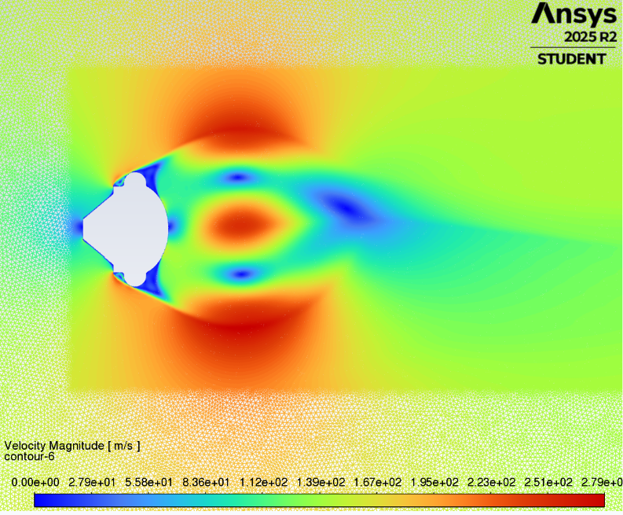
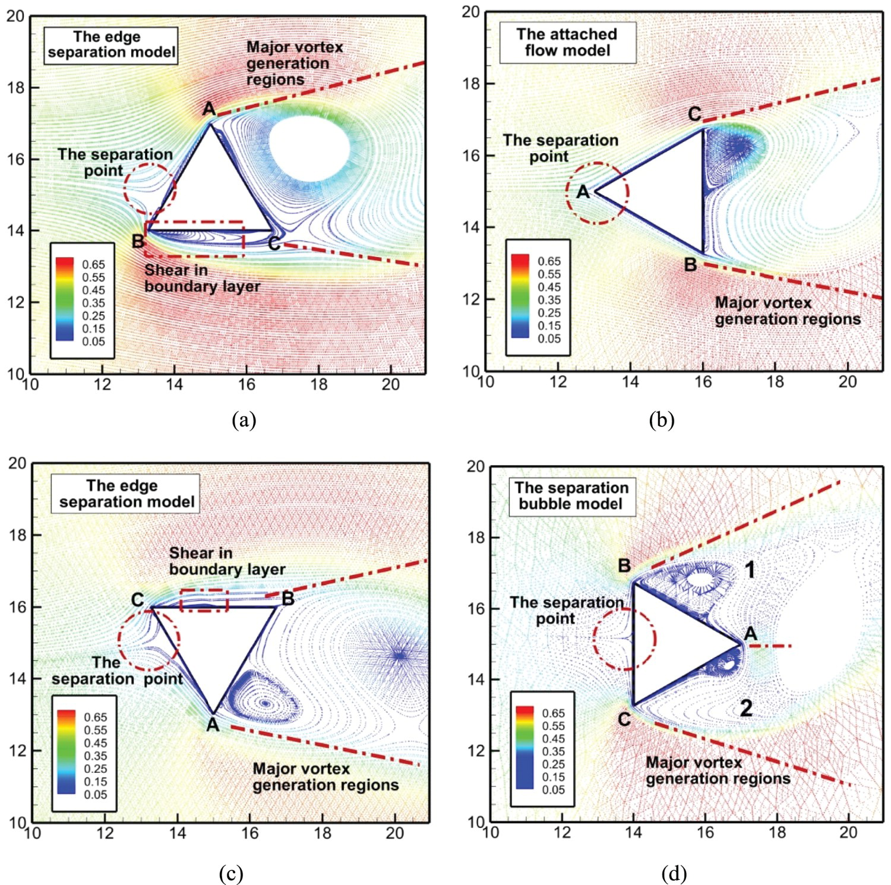
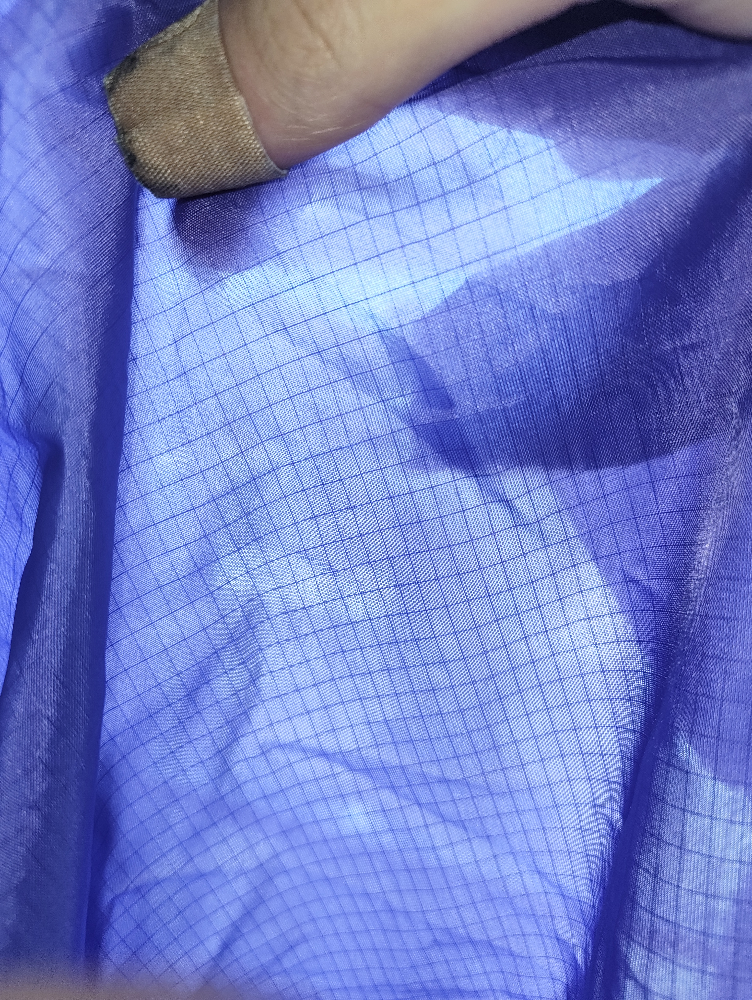

# Ballute Testing
> [!NOTE]
>This is a journal of sorts detailing the thought process in this project and is intentionally unserious in nature. It is a way for me to keep track of design rationalisations and have some fun :D
## Brief
During my time at Monash High Powered Rocketry I designed a high alttitude recovery parachute. This is a novel concept called a ballute. For more details see the [report section](../ballute.md) I wrote on it. 

The parachute was designed for a 100,000 ft (30 km) rocket. A ballute was selected over a traditional drogue parachute due to the inability to model low density inflation dynamics that could lead to a irrecoverable canopy collapse. The ballute addresses this problem by using an inflatable design that can inherently not enter an unstable collapsed configuration, using the weight of the rocket to allign vents with incoming airflow. 

Now that I have graduated others will carry on the final manufacturing and testing of the ballute. I want to manufacture this parachute at home to test it, purely out of curiosity and passion.

## Goals and Expectations
There are a few things I want to get from manufacturing and testing this parachute.

### Manufacturability 
Clearly this is a strange parachute, and it will be strange to make. It has been made on the hobby level and [professional level](https://www.youtube.com/watch?v=4WhBfoOEUjY) so it is certainly possible. The student team is currently manufacturing one, the steps are clear and feasible. I wish to try and improve upon this process and find downfalls that can be improved through trial and error.

### Behaviour
The ballute is a device made for high subsonic and supersonic airflow, so its behaviour in lower speed regimes is of great interest. Companies such as [Copenhagen Sub-orbitals](https://copenhagensuborbitals.com/) have done low speed drop tests and the ballute performed well, inflating and effectively slowing the payloads descent. Doing further drop tests will validate estimates of inflation pressure at certain flight stages as detailed in the [report](../ballute.md). Additionally, physically verifying the ballute remains positively pressured at low speeds is a great sanity check for the final stage of descent for this parachute before the main parachute deploys.

## Aerodynamic Conversation?
Before manufacturing the ballute I'd like to write some qualitative discussion on [CFD](Ballute%20CFD%20Validation%20Report) that was conducted for this parachute to better understand the flow characteristics around the parachute. While the simulation could be improved, it will still provide valuable insights. 

The parameters for the below simulation are:
* Airspeed 140 $m\ s^{-1}$
* Air Density 0.17 $kg\ m^{-3}$
* Air Dynamic Viscosity  0.00001472 $Pa\ s$ (27 km)
* Reynolds Number 2,368,682 (Ref length 1.456 m) 

The rigid-body airflow simulation of the ballute above, conducted at an airspeed of 129 m/s and an altitude of 27 km, indicates an expected stagnation region along the leading edge of the burble fence, followed by extensive flow separation downstream. This separated flow is the primary mechanism contributing to the ballute’s aerodynamic drag. The resulting pressure distribution may also influence the ballute’s structural deformation, causing the forward surface to flex inward while the aft region bulges outward in response to the lower pressures along the sides.

Comparing this to the potential flow around a cylinder (Due to high Re) the similarities are clear. With stagnation regions fore and aft of the parachute and accelerating flow over the burble fence. 

However the more complex wake characteristics apparent in the CFD simulation are not present for standard cylinder flow. Perhaps looking at a triangular bluff body will reveal the mechanism behind these formations. From a [CFD study on flow fields around equilateral triangles](https://www.tandfonline.com/doi/full/10.1080/19942060.2020.1721332#d1e2168) some further insight can be gained. 

We can see here the flow has a significant free shear layer similar to the ballute where the detached boundary layer from the burble fence creates a harsh gradient between the wake and the free stream. At this point it is wise to mention there is definitely necking in this simulation (is that what it's called?). The boundaries of the simulation domain are clearly not large enough, the constriction of the flow between the ballute and the spanwise domain walls are causing artificial acceleration of the flow which may exaggerate actual flow acceleration.

## Geometry Sizing
The rocket has a designed diameter of 1.465 metres for its intended rocket. Creating a smaller test article is less expensive and easier to test. Implementing Reynolds similarity will match the inertia dominated flow of the ballute in its design case. The desirable characteristic is the diameter so that will be used to inform the required descent velocity for testing. 

Well, forget all of that. Upon initial iterations not documented here, it seems the parachute needs to be quite large to match the Reynolds number without requiring a ridiculous airspeed. It appears drop testing will not be feasible as the airspeed requirements are too large. As a matter of fact, I am legally bound to 100 km/h on Victorian roads so unless I find a private runway, I am also restricted by testing speeds. It would have been nice to control the diameter over the airspeed but it appears for this high Reynolds number, the road laws will be the limiting factor.

$$
L = \frac{Re \mu}{\rho V} = 1.158 m
$$

That diameter is a little larger than I'd like which is unfortunate, but it will make some other sewing problems more manageable down the line, there's always a good view at the end of the world! This test parachute will be 79% the size of the original. Now that the preliminary maths is complete. It is time for material selection!

## Material Selection
For the original design, the selected material is [70 GSM ripstop polyester](https://www.extremtextil.de/en/polyester-pu-coated-70g-sqm/70278.WEI) with a polyurethane coating. What the polyester lacks in tensile strength compared to nylon it makes up for in its UV resistance, low temperature resilience and hydrophilic nature which is an important factor for high altitude flight. 

The lowest air temperature expected is -64 C which is pretty cold! Given this is completely new territory I moved like Murphy and acted like everything was trying to kill me. I assumed that absorbed moisture in the fabrics would freeze into crystals that potentially compromise the structural integrity of the fabric. This made polyester the safer choice as it should have better resistance to lower temperatures, and unlike nylon, it will not absorb moisture on the molecular level. There is no easy way to verify this choice. Polyester is quite inflexible compared to nylon which may cause problems. There are 1000 ways this design could fail and only 1 way it could succeed... How terrifying!

### Fabric Porosity

Another design consideration is the porosity of the fabric. The aforementioned Polyester is PU coated which gives the fabric an effective porosity of zero. This allows the design to act like a balloon and only lose air through seams and vents. Is it truly necessary to have a non-porous fabric? Would the ballute remain inflated with a lower rigidity? Upon initial consideration as long as the mass of air lost through the fabric is balanced by air through the inlets the ballute should stay inflated. To approximate mass flow through the fabric a porous medium approximation for the expected pressure difference across the ballute walls should be conducted. The flow will be highly turbulent so the standard linear Darcy's Law will not suffice. The [Forchheimer non-linearity](https://www.simscale.com/knowledge-base/predict-darcy-and-forchheimer-coefficients-for-perforated-plates-using-analytical-approach/) must be added and is seen below in it's 1-dimensional form.

$$
-\delta P = \mu d L u_D + \frac{\rho}{2} f L u^2
$$
- p: pressure drop
- $$\mu$$: fluid viscosity
- d: Darcy linear viscous coefficient
- L: fabric thickness
- $$u_D = Q/A$$: Darcy velocity
- $$\rho$$: fluid density
- f: Forchheimer coefficient

For this highly turbulent flow the viscous linear term can be neglected. The Forchheimer coefficient is given by 

$$
f=\frac{k}{L}
$$

Where k is the pressure resistance factor which can be given by

$$
k = [0.707*(1-\phi)^{0.375}+1-\phi ^2]*\frac{1}{\phi^2}
$$

$$\phi$$ is the fabric porosity which is the pore area to total area ratio. For non circular holes the hydraulic diameter can be given by

$$
d_h = \frac{4 \times open \ area}{wet\  perimeter}
$$
$$
d_h = \frac{4 \times open\ volume}{wet\ surface\ area}
$$

This follows Idelchik's method which is available for $0 < \frac{L}{d_h} < 0.015$ and $Re > 10^5$

Phew, that was a lot, I guess I should've expected that. Overall the equation is quite simple though and behaves as expected in relation to medium thickness and Darcy velocity. The real ugly stuff is the empirical estimation, which are rarely pretty. I don't have any fabric at the moment but a problem I am anticipating is calculating porosity. Ripstop nylon is quite tightly woven, would I even be able to accurately estimate it's porosity? Is this entire theoretical mass flow approximation pointless due to the physical inaccuracies that will be introduced? Why do I do anything in this infinite universe??? 

Well at least I feel like I can tackle that porosity question... 

Here is a photo of some 70 GSM ripstop nylon I have lying around compared to my slightly wounded thumb. Clearly the 'pores' are at a scale where I need a microscope to confidently measure them.

But, if I assume the fabric is entirely made of nylon with no pores then I can find the weight it should be, hence the weight that the pores remove! Like a missile or something. The fabric weighs 30 grams on my kitchen scale, which arguably is lacking some precision, whatever. The fabric is 1.01 x 0.45 x 0.00014 m and weighs 30 grams. Nylon 66 is about 1.14 $g/cm^3$, so with a volume of 63.63 $cm^3$ the fabric should actually weigh 72.5 g.

This means we can equate our weight fraction to our void fraction assuming the fibres don't have an egregious amount of space inside them for some reason (they don't).

$$
\phi = \frac{V_{Void}}{V_{Total}} = 1 - \frac{m_{fabric}}{m_{solid}} = 0.586\ or\ 58.6 \\%
$$

This value is right in the range I am expecting, nice! Maybe you aren't so bad after all steely kitchen scale.

Now to find the Forchheimer coefficient we have

$$
k = [0.707*(1-\phi)^{0.375}+1-\phi ^2]*\frac{1}{\phi^2} = 3.391
$$

$$
f = \frac{k}{L} = \frac{3.391}{00.00014} = 24222.8\ m^{-1}
$$

The Idelchik approach assumes that Darcy's coefficient is zero and given I expect the flow to be highly turbulent, assuming an inertially driven flow is not unreasonable. TBC....
